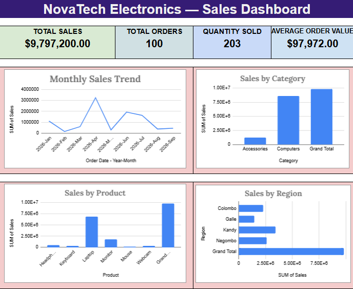

# 📊 Small Business Sales Dashboard — Excel Data Analysis Project

## 📌 Project Overview

This project demonstrates how Microsoft Excel can be used to organize, analyze, and visualize sales data for a fictional small business, **NovaTech Electronics**.

The dashboard summarizes sales performance by month, product, category, and region to help users understand business performance through clear visualizations and key performance indicators (KPIs).

## 🎯 Project Objectives

- Organize and review raw sales data.
- Prepare a clean dataset for analysis.
- Use Excel formulas to calculate sales metrics.
- Create PivotTables to summarize sales performance.
- Build an interactive-looking, visual sales dashboard.
- Present business information in a clear and professional format.

## 🛠️ Tools & Technologies

- Microsoft Excel
- Excel Formulas
- PivotTables
- PivotCharts
- Data Cleaning
- Data Visualization
- Business Data Analysis

## 📂 Project Structure

```text
Sales-Dashboard-Project/
├── sales_data.xlsx
├── README.md
├── data/
│   └── novatech_sales_records.csv
├── screenshots/
│   └── sales_dashboard.png
├── reports/
└── documentation/
```

## 📈 Dashboard Features

### Key Performance Indicators (KPIs)

- Total Sales
- Total Orders
- Quantity Sold
- Average Order Value

### Visualizations

- Monthly Sales Trend
- Sales by Category
- Sales by Product
- Sales by Region

## 🧹 Data Preparation

The project includes a raw dataset and a separate worksheet for cleaned data. Excel formulas are used to calculate sales values and check calculations.

## 📊 Analysis Approach

1. Review the raw sales dataset.
2. Prepare the `Clean_Data` worksheet.
3. Calculate sales metrics using Excel formulas.
4. Summarize sales using PivotTables.
5. Create PivotCharts for different sales dimensions.
6. Combine the KPIs and charts into one dashboard.
7. Review the results for accuracy.

## 💡 Business Questions

- How do sales change from month to month?
- Which product category generates the most sales?
- Which products contribute most to total sales?
- Which region records the highest sales?
- What is the average order value?

## 🖼️ Dashboard Preview



## 📁 Files Included

- `sales_data.xlsx` — Excel workbook containing the project worksheets, formulas, PivotTables, and dashboard.
- `data/novatech_sales_records.csv` — CSV copy of the dataset.
- `screenshots/sales_dashboard.png` — Dashboard preview image.

## ⚠️ Data Disclaimer

NovaTech Electronics and the sales records used in this project are fictional and intended for educational and portfolio demonstration purposes.

## 👩‍💻 Author

**Dilki Sandeepani**

IT Graduate | Web Development | UI/UX | Software QA & Data Analytics

## ⭐ Project Status

Excel dashboard development and data quality review completed. Additional documentation and portfolio presentation can be developed as needed.