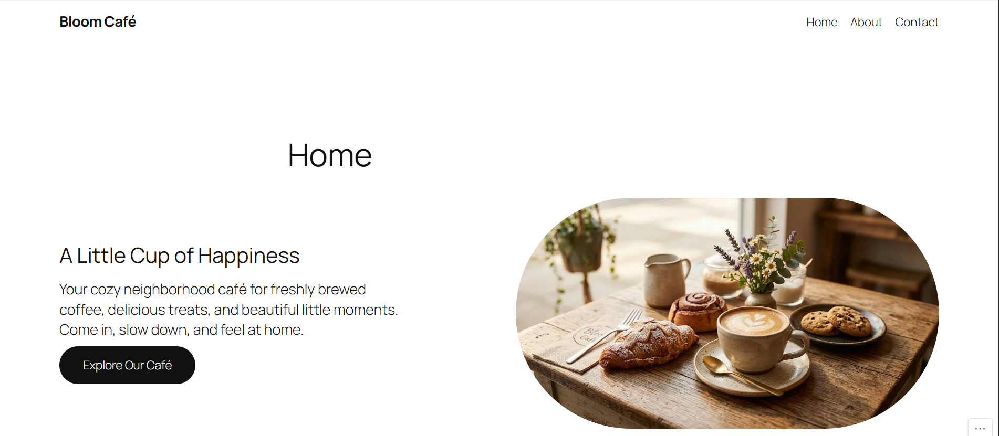
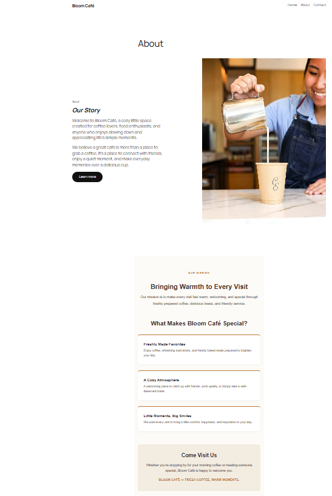
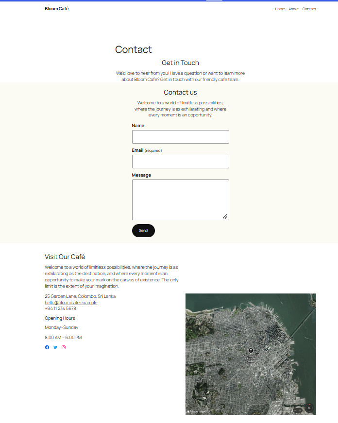

# Bloom Café — Responsive WordPress Business Website

A beginner portfolio project showcasing a fictional café business website built with WordPress.com.

## Project Overview

**Bloom Café** is a café website project created to practise building, organising, and testing a small-business website using WordPress.com.

The website presents a fictional café through three main pages: Home, About, and Contact. The project also demonstrates basic website navigation, responsive layout checks, contact form testing, and website quality assurance.

## Live Website

- **Website:** https://bloomcafesite.wordpress.com/
- **Home:** https://bloomcafesite.wordpress.com/home
- **About:** https://bloomcafesite.wordpress.com/about/
- **Contact:** https://bloomcafesite.wordpress.com/contact/

## Project Details

| Item | Details |
|---|---|
| Project name | Bloom Café — Responsive WordPress Business Website |
| Project type | Small-business website |
| Business concept | Fictional café |
| Platform | WordPress.com |
| Theme | Twenty Twenty-Five |
| Hosting | WordPress.com |
| Main pages | Home, About, Contact |
| Project purpose | Beginner portfolio and website testing practice |
| Project status | Website published; portfolio documentation in progress |
| Developer | [Dilki] |
| Completion date | [2026.10.21] |

## Project Objectives

The main objectives of this project are to:

- Build a simple business website using WordPress.com.
- Organise the website into clear, easy-to-navigate pages.
- Check navigation links and page URLs.
- Test the website on desktop, tablet, and mobile screen sizes.
- Test the contact form using a sample submission.
- Check image alternative text and heading structure.
- Document test results and known limitations.
- Present the project as evidence of practical website-building and quality-assurance skills.

## Website Pages

### 1. Home

**URL:** https://bloomcafesite.wordpress.com/

The Home page introduces the Bloom Café concept and acts as the main entry point to the website.

Planned content areas include:
- Café introduction and hero section
- Food and drink information
- Café services
- Calls to action
- Customer testimonials
- Contact and social links in the footer

*Note: Update this list if any planned content area is not present in the published version.*

### 2. About

**URL:** https://bloomcafesite.wordpress.com/about/

The About page provides information about the café concept.

*Add a short description of the final published page here if you want to document its exact content.*

### 3. Contact

**URL:** https://bloomcafesite.wordpress.com/contact/

The Contact page includes a contact form. A test submission was made, and the submission was subsequently restored from Spam to the normal Feedback list.

**Email notification delivery:** Not confirmed in this documentation. Do not assume that email notifications work until delivery has been verified.

## Tools and Technologies

- **WordPress.com** — website creation and hosting
- **Twenty Twenty-Five** — active WordPress theme
- **WordPress Site Editor and Styles** — website design customisation
- **Web browser** — website testing and verification
- **GitHub** — project documentation and portfolio evidence

*Add any additional tools only if you actually used them.*

## Testing and Quality Assurance

The following checks have been reported as completed.

| Test area | Reported result | Notes |
|---|---|---|
| Home page access | PASS | Page opens at the expected URL |
| About page access | PASS | Page opens at the expected URL |
| Contact page access | PASS | Page opens at the expected URL |
| Main navigation | PASS | Home, About, and Contact links work |
| Desktop layout | PASS | Desktop view checked |
| Tablet layout | PASS | Tablet view checked |
| Mobile layout | PASS | Mobile view checked |
| Contact form | PASS | Test submission completed |
| Feedback handling | PASS | Test submission restored from Spam |
| Footer | PASS | Footer work reported as completed |
| Image alternative text | CHECKED | Alternative text reviewed |
| Heading structure | CHECKED | Home page H1 and section H2 headings reviewed |
| SEO title and meta description | NOT CONFIGURED / UNVERIFIED | Fields were not found in the current interface |
| Search engine visibility | UNVERIFIED | Setting was not found in the current interface |
| Email notifications | UNVERIFIED | Successful email delivery has not been confirmed |

**Important:** These results reflect the checks reported during project development. Repeat any test if the website changes, and update this table to reflect the latest evidence.

## Screenshots

Add screenshots of the published website to a `screenshots/` folder in this repository.

Suggested filenames:

- `home-desktop.png`
- `home-mobile.png`
- `about.png`
- `contact.png`

Once the files have been added, use these Markdown links to display them:

### Home — Desktop

### Home — Mobile

### About Page

### Contact Page

*If a screenshot has not yet been added, add the image file before relying on its preview in this README.*

## Known Limitations

- This is a WordPress.com-hosted website, not a standalone HTML application.
- The website is built around a fictional café concept.
- The current project documentation does not include a downloadable copy of the WordPress.com site's complete source code.
- SEO title and meta description configuration has not been verified.
- Search engine visibility settings have not been verified.
- Successful delivery of contact form email notifications has not been verified.
- Screenshot files must be added to the repository before they can be displayed here.

## What I Learned

Use this section to describe skills you personally practised during the project. Possible topics include:

- Creating and publishing pages in WordPress.com
- Customising a WordPress theme
- Setting up and checking website navigation
- Testing a contact form
- Checking responsive layouts
- Reviewing image alternative text and heading hierarchy
- Recording test results and documenting limitations

## Future Improvements

Potential improvements, subject to project requirements and available WordPress.com features:

- Verify contact form email notification delivery.
- Review search engine visibility and available SEO settings.
- Add and organise final project screenshots.
- Complete a documented regression test after any major change.
- Add a portfolio case study with screenshots and test evidence.

## How to View the Project

1. Open the live website: https://bloomcafesite.wordpress.com/
2. Visit the Home, About, and Contact pages.
3. Use the main navigation to move between pages.
4. Open the Contact page to view the contact form.

The website is hosted on WordPress.com, so editing requires access to the relevant WordPress.com site account.

## Project Status

The website has been published, and the main page, navigation, responsive-layout, and contact-form checks have been reported as completed. Documentation and portfolio presentation are still being prepared.

## License and Usage

This repository is intended to document a personal portfolio project.

Unless a separate license is added, no reuse or redistribution license is granted by this README. Check the rights and terms for any images, fonts, themes, or other assets used in the website before reusing them.

---

**Portfolio note:** This project demonstrates practical website creation, basic testing, and documentation. All claims should match the published website and the tests actually performed.
