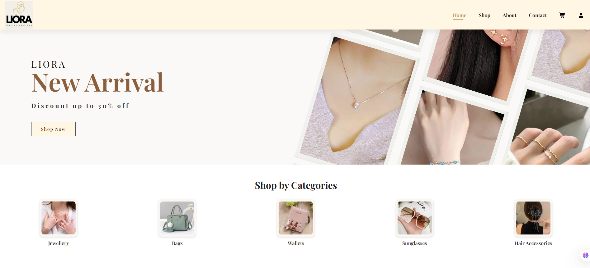
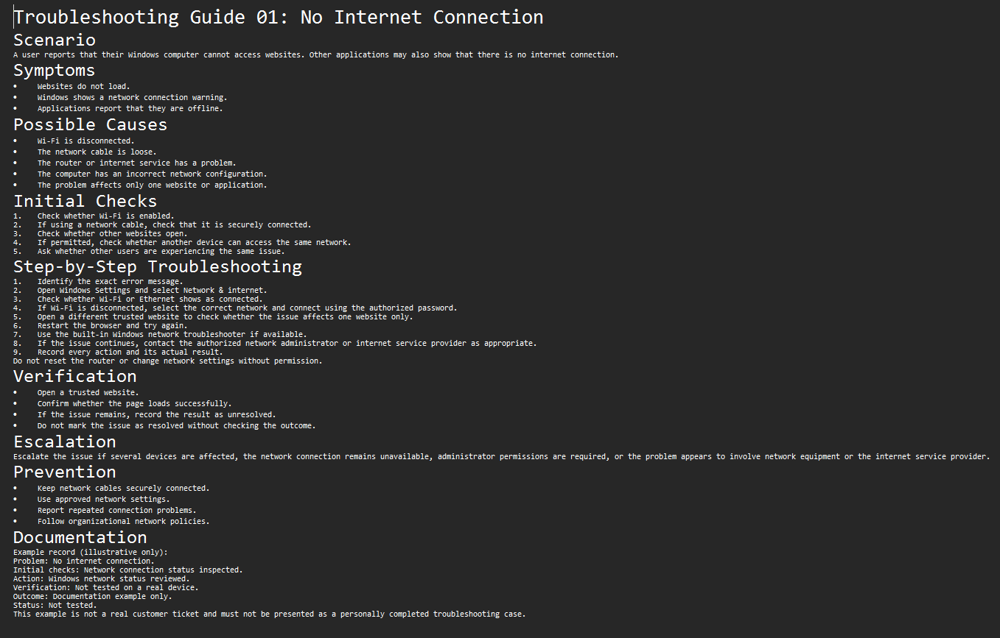
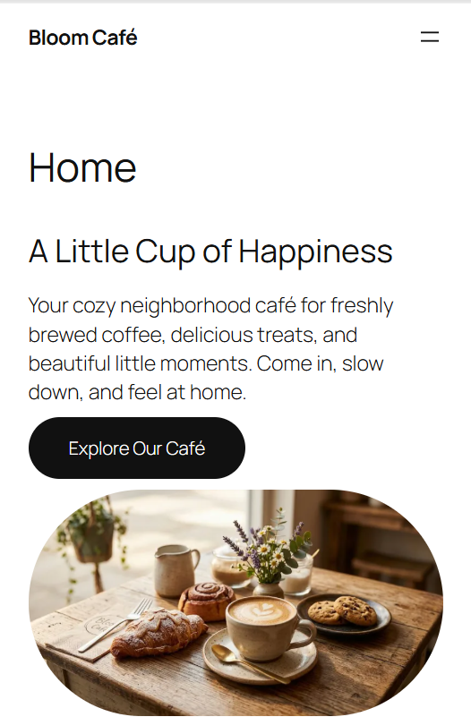
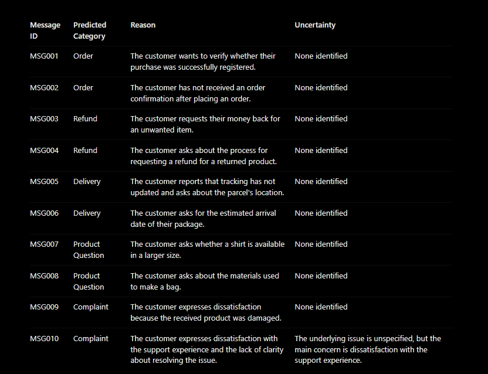

# Mini Projects Portfolio

Welcome to my portfolio! This repository showcases six practical projects demonstrating my skills in data analytics, Python, software quality assurance, IT support, WordPress, and AI-assisted workflows.

## Projects

### 01 — Small Business Sales Dashboard
**Tools:** Microsoft Excel, Data Analysis

Analyzed sample sales data and created a dashboard to help understand business sales performance.

[View Project](01-sales-dashboard/)

### 02 — Customer Data Cleaning Tool
**Tools:** Python, Pandas, CSV

Created a Python tool to clean customer data, handle common data-quality issues, and produce a summary report.

[View Project](02-python-data-cleaning/)

### 03 — LIORA Fashion Website QA Testing
**Tools:** Software Testing, Test Cases, Bug Reporting, Excel

Documented testing for my LIORA fashion e-commerce website, including test cases, execution results, bug-report documentation, and screenshot evidence.

[View Project](03-liora-fashion-qa/)

### 04 — IT Support Troubleshooting Knowledge Base
**Tools:** IT Support Documentation, Troubleshooting

Created practical troubleshooting guides for common IT issues, supported by screenshots and a troubleshooting log.

[View Project](04-it-support-knowledge-base/)

### 05 — Bloom Café WordPress Business Website
**Tools:** WordPress, Website Design, Responsive Design

Developed a small business website project for a café, with documentation and desktop/mobile screenshots.

[View Project](05-bloom-cafe-wordpress/)

### 06 — AI-Assisted Customer Support Workflow
**Tools:** AI Prompt Design, Customer Message Classification, Human Review

Designed a workflow to categorize sample customer messages and prepare support responses with human review.

[View Project](06-ai-customer-support-workflow/)

## Skills Demonstrated

- Data analysis and reporting
- Python and data cleaning
- Software QA and test documentation
- IT troubleshooting and technical documentation
- WordPress and responsive web design
- AI-assisted workflows and prompt design
- Documentation, organization, and problem-solving

## About This Portfolio

These projects were created for practical learning and portfolio demonstration. Sample data is used where applicable. Please refer to each project's README and documentation for its scope, tools, limitations, and results.

**Note:** The Bloom Café project is presented through its available documentation and screenshots. A live website link is not included here.
